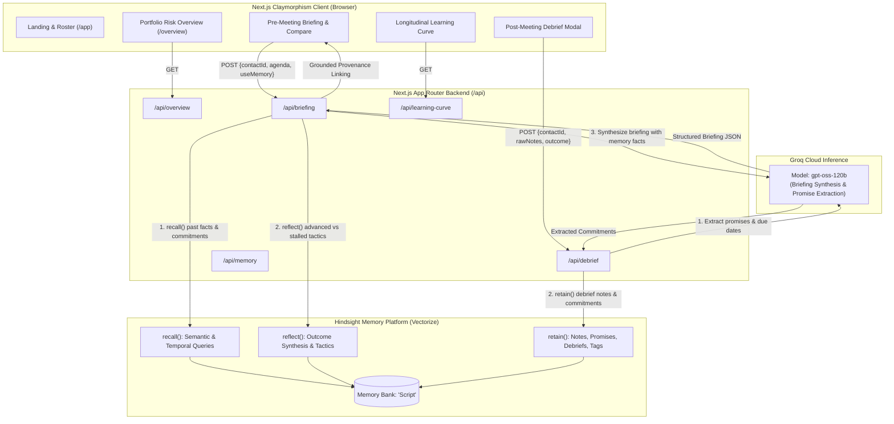
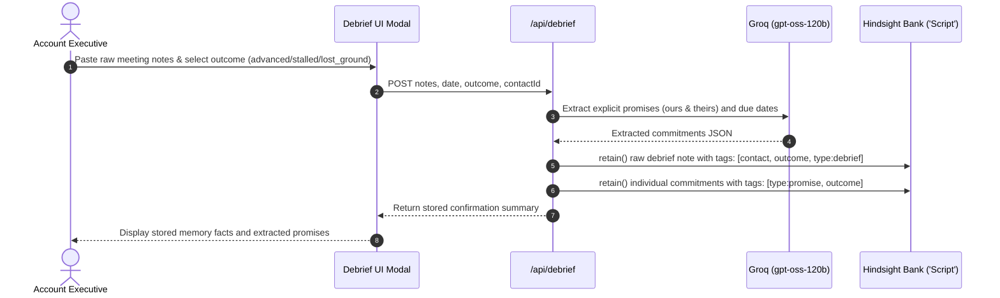
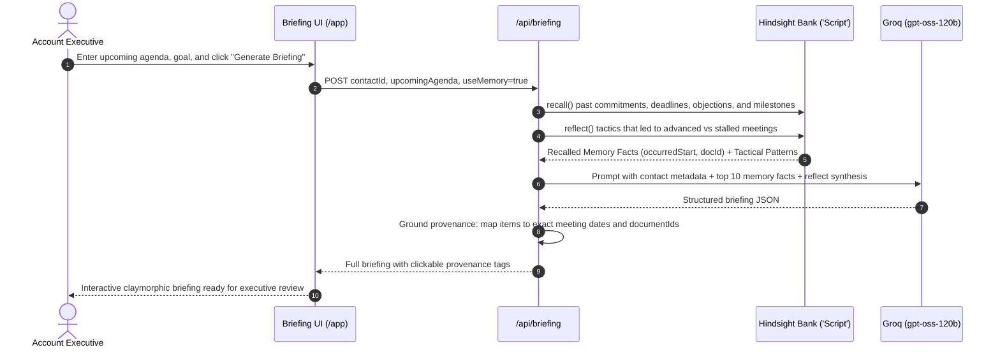

# Foresight — Detailed Project Documentation

> **Project:** `foresight` (Next.js 16 / React 19 / TypeScript)  
> **Purpose:** Executive meeting preparation with **persistent relationship intelligence** powered by **Vectorize Hindsight** (memory bank) and **Groq** (LLM inference).  
> **Repository (this workspace):** `c:\Users\nikhileswar\Documents\foresight`

This document provides a detailed reference for the product concept, architecture, memory lifecycle, core capabilities, setup, error handling, automated tests, and the Claymorphism design system. The final section reproduces the project README.

---

## Table of Contents

1. [Foresight: Persistent Relationship Intelligence](#1-foresight-persistent-relationship-intelligence)
2. [Architecture Overview](#2-architecture-overview)
3. [Memory Retain and Recall Lifecycle](#3-memory-retain-and-recall-lifecycle)
   - [3.1 Retain Flow (After Every Meeting)](#31-retain-flow-after-every-meeting)
   - [3.2 Recall Flow (Before Upcoming Meetings)](#32-recall-flow-before-upcoming-meetings)
4. [Core Capabilities](#4-core-capabilities)
5. [Setup and Installation](#5-setup-and-installation)
6. [Error Handling Architecture](#6-error-handling-architecture)
7. [Running the Automated Test Suite](#7-running-the-automated-test-suite)
8. [Design System: Claymorphism](#8-design-system-claymorphism)
9. [Readme](#9-readme)

---

## 1. Foresight: Persistent Relationship Intelligence

**Foresight** is an executive meeting preparation system designed so that an account executive or relationship owner never walks into a meeting having forgotten:

- past commitments (ours and theirs),
- unresolved objections or open questions,
- shifting stakeholder sentiment and trust trajectory,
- tactics that historically advanced vs. stalled the relationship.

### What “Persistent Relationship Intelligence” means in this system

| Layer | Role | Implementation |
|---|---|---|
| **Persistent memory (“hippocampus”)** | Stores structured facts, temporal metadata, document IDs, tags, and context across meetings so knowledge survives beyond a single chat/session. | **Vectorize Hindsight** via `@vectorize-io/hindsight-client` (`lib/hindsight.ts`). Default bank ID: `process.env.HINDSIGHT_BANK_ID \|\| 'Script'`. |
| **Reasoning & synthesis** | Converts recalled facts + contact context + agenda into a structured, actionable briefing; extracts promises from raw debrief notes. | **Groq Cloud** via `groq-sdk` (`lib/groq.ts`). Default model: `process.env.GROQ_MODEL \|\| 'openai/gpt-oss-120b'`. |
| **Application surface** | Roster/workspace, portfolio risk view, briefing generation, post-meeting debrief, memory exploration, and longitudinal learning curve. | **Next.js App Router** pages under `app/` and API routes under `app/api/`. |
| **Grounding/provenance** | Briefing items can be linked back to source meeting dates/document IDs so claims are auditable. | `/api/briefing` normalizes LLM output and runs `groundItem()` against recalled `MemoryFact`s (`occurredStart`, `documentId`). |

### Key design principles (as implemented)

- **Memory-aware by default, but toggleable:** Briefing generation supports `useMemory` (default `true`); `useMemory: false` produces an explicit “without memory” baseline (no recalled facts, placeholder relationship/tactics).
- **Provenance over invention:** When memory is enabled, the briefing prompt instructs the model not to invent sources; server-side grounding validates/repairs `sourceDate`/`sourceDocumentId` or nulls them.
- **Graceful degradation:** External failures (Groq rate limits/outages, Hindsight connectivity) are surfaced as structured JSON errors (`service`, `statusCode`, `rawError`) for the UI to render actionable messages.

---

## 2. Architecture Overview

Foresight sits on two core backbones:

1. **Vectorize Hindsight (`@vectorize-io/hindsight-client`)** — persistent hippocampus: `retain()`, `recall()`, `reflect()`, document operations.
2. **Groq (`groq-sdk`)** — low-latency reasoning/synthesis using open-weight models (default `openai/gpt-oss-120b`).

### High-level component diagram



### API routes (implemented)

| Route | Method(s) | Purpose | Key dependencies |
|---|---|---|---|
| `/api/briefing` | `POST` | Generate pre-meeting briefing (with/without memory), recall+reflect, Groq synthesis, provenance grounding. | `lib/store` (contact lookup), `lib/hindsight.recall/reflect`, `lib/groq.chatCompletion/safeParseJson` |
| `/api/debrief` | `POST` | Post-meeting ingestion: Groq extracts summary/promises/questions, saves local note, retains debrief + individual promises to Hindsight. | `lib/store.addMeetingNote`, `lib/hindsight.retain`, `lib/groq` |
| `/api/notes` | `GET`, `POST` | List notes by `contactId`; create a structured meeting note and (best-effort) retain it to Hindsight. | `lib/store`, `lib/hindsight.retain` |
| `/api/memory` | `POST` | Ad-hoc semantic recall (`query`, optional `contactId`, `budget`). | `lib/hindsight.recall` |
| `/api/overview` | `GET` | Returns portfolio risk summary (currently **static in-route data**: `portfolioOverviewData`). | `types/PortfolioRiskSummary` |
| `/api/learning-curve` | `GET` | Returns cached longitudinal learning curve for a contact (defaults to `contact-elena-rostova`) from `data/learning-curve-cache.json`. | `lib/store.getContactById`, cache file |
| `/api/contacts` | *(present in repo)* | Contact roster operations (see `app/api/contacts/route.ts`). | `lib/store` |

### Data & storage

| Asset | Location | Role |
|---|---|---|
| Seed/local store | `data/seed-meetings.json` | JSON-backed `contacts[]` and `meetings[]` read/written by `lib/store.ts` (filesystem). |
| Learning curve cache | `data/learning-curve-cache.json` | Pre-generated curve payload served by `/api/learning-curve` (instant demo). Top-level keys include `contact`, `upcomingAgenda`, `meetingGoal`, `stages`, `generatedAt`. |
| Hindsight memory bank | External (Vectorize) | Long-term retained facts; queried via recall/reflect and tagged (e.g., `contact:*`, `type:debrief`, `type:promise`, `outcome:*`). |

### Core library modules

- **`lib/hindsight.ts`**: `getHindsightClient()`, `retain()`, `recall()`, `reflect()`, `deleteDocument()`. Handles bank ID resolution, tag composition, metadata sanitization, fact mapping (`occurred_start` → `occurredStart`, `document_id` → `documentId`), and prompt-friendly recall summary.
- **`lib/groq.ts`**: `chatCompletion()` with retry/backoff for transient errors; `safeParseJson()` (direct parse, markdown fence extraction, brace slicing, light sanitization); `chatWithToolCallingRecovery()` helper for agentic tool-call repair (available utility).
- **`lib/store.ts`**: synchronous JSON file store (`getAppData`, `saveAppData`, `getContactById`, `getMeetingsByContact`, `addMeetingNote`, etc.).

---

## 3. Memory Retain and Recall Lifecycle

This section details how meeting knowledge is **written** into persistent memory after meetings and **read/synthesized** before upcoming meetings.

### 3.1 Retain Flow (After Every Meeting)

The primary post-meeting path is **`POST /api/debrief`** (outcome-tagged debrief + extracted promises). A simpler structured note path also exists via **`POST /api/notes`**.

#### Sequence (Debrief — implemented behavior)



#### Implementation details (`app/api/debrief/route.ts`)

1. **Validation:** requires `contactId`, `date`, `outcome`, `rawNotes`; `outcome` ∈ `{advanced, stalled, lost_ground}`; contact must exist in store.
2. **Outcome → sentiment mapping:** `advanced → positive`, `stalled → mixed`, `lost_ground → negative`.
3. **Groq extraction (best-effort):** prompts for JSON `{ summary, ourPromises[], theirPromises[], openQuestions[] }` (each promise: `promise`, `dueDate`, `owner`). Parsed via `safeParseJson`. On Groq extraction failure, logs a warning and proceeds with defaults/empty arrays (debrief still attempts to save/retain).
4. **Local persistence:** builds `MeetingNote` (`id: debrief-${contactId}-${Date.now()}`), combines promise strings into `promisesMade`, saves via `addMeetingNote()`.
5. **Retain debrief note (Hindsight):** content includes outcome, executive summary, and raw notes. Metadata/tags include `contact:${id}`, `outcome:${outcome}`, `type:debrief`, `type:meeting`; `documentId` = note ID.
6. **Retain promises individually:** for each `ourPromises`/`theirPromises` item, calls `retain()` with tags like `type:promise`, `promise:our`/`promise:their`, `contact:*`, `outcome:*`. Returns `retainedPromiseCount`.
7. **Response:** `{ success, contact, meetingNote, outcome, retainedNoteMemory, extractedPromises, retainedPromiseCount, storedAt }`.

#### Alternate retain path (`POST /api/notes`)

- Accepts structured fields (`contactId`, `date`, `summary`, optional `promisesMade`, `openQuestions`, `sentiment`, `rawNotes`, `actionItems`).
- Saves to local store and **attempts** to retain a composed memory string to Hindsight (tags include `contact:*`, company slug, `sentiment:*`; documentId `meeting-${contact.id}-${noteId}`). Returns `memoryRetained` and optional `retainError` (note can be saved locally even if retain fails).

#### Hindsight `retain()` behavior (`lib/hindsight.ts`)

- **Bank:** `metadata.bankId || HINDSIGHT_BANK_ID || 'Script'`.
- **Tags:** merges provided tags + `contact:${contactId}` + raw `contactId` (deduped).
- **Timestamp/context/metadata/documentId:** derived from metadata; arbitrary metadata sanitized to string map (excluding `tags`, `bankId`, `documentId`).
- **Errors:** throws `Failed to retain memory in Hindsight: ...` (callers decide how to surface).

---

### 3.2 Recall Flow (Before Upcoming Meetings)

The primary pre-meeting path is **`POST /api/briefing`**.

#### Sequence (Briefing — implemented behavior)



#### Implementation details (`app/api/briefing/route.ts`)

1. **Inputs:** `contactId` (required), `upcomingAgenda`, `meetingGoal`, `useMemory` (default `true`).
2. **Contact resolution:** 400 if missing `contactId`, 404 if contact not found.
3. **Memory retrieval (only when `useMemory` is true):**
   - Builds 4 recall queries (discussions/milestones/agreements; promises/deadlines; open questions/objections/compliance; outcomes/tactics from debriefs) + optional agenda-specific query.
   - Runs `Promise.allSettled` over `recall(..., { contactId, budget: 'mid', maxTokens: 4000 })` and a parallel `reflect(..., { contactId, budget: 'low' })` (reflect failures are logged and return empty text).
   - Deduplicates facts by `fact.text`.
   - **All recalls failed:** returns **502** with `service: 'hindsight'`, including bank ID in the message.
4. **Prompt construction:** uses top **10** facts (TPM control). Formats each as `[Fact i | Date: ... | DocID: ...] ... [Context: ...]`. Appends truncated reflect synthesis (up to ~700 chars) when present.
5. **Modes:**
   - **With memory:** strict JSON schema (executive summary, relationship health, commitments with provenance fields, unresolved questions, `recommendedApproach` with advancing/stalling tactics, agenda, talking points, red flags/sensitivities). Instructs: no emojis, no em dashes, concise reasoning, explicit reference to advanced vs stalled tactics.
   - **Without memory:** explicit placeholders (`unknown` status, “memory disabled” trajectory/tactics, empty commitments/questions/red flags).
6. **Groq call:** `chatCompletion` (default model from env), `temperature: 0.1`, `max_tokens: 3800`. Handles rate limits (429) and service errors (502) with structured responses.
7. **Parsing & normalization:** `safeParseJson`; defensive key normalization (e.g., `questions` → `unresolvedQuestions`, string red flags → objects).
8. **Provenance grounding (`groundItem`):** when memory enabled, attempts to match LLM-provided `sourceDate`/`sourceDocumentId` to recalled facts; falls back to keyword overlap (words ≥4 chars, score ≥2) against fact text; otherwise nulls sources to avoid fabrication. Without memory, forces placeholder/empty structures.
9. **Response:** `{ contact, briefing, relevantMemories, reflectSynthesis?, useMemory, generatedAt }`.

#### Hindsight `recall()` behavior (`lib/hindsight.ts`)

- Adds `contact:${contactId}` tag filter when `contactId` provided.
- Maps SDK results to `MemoryFact[]` with temporal fields and `documentId`.
- Builds `rawSummaryPrompt` via `recallResponseToPromptString` (fallback to bullet list).
- Throws on failure (`Failed to recall memories...`).

#### Hindsight `reflect()` behavior

- Agentic synthesis over memories (`budget` default low). On error, logs warning and returns `{ text: '' }` (non-fatal for briefing flow).

---

## 4. Core Capabilities

### 4.1 Portfolio Risk Overview (`/overview`)

- **Route:** `GET /api/overview` returns `portfolioOverviewData` (static structure in code).
- **UI:** `app/overview/page.tsx` (risk-ranked portfolio view).
- **Content (as implemented in API data):** 4 enterprise accounts ranked by risk (e.g., `#1 Elena Rostova` Critical/at_risk, `#2 Amara Chen` High/at_risk, `#3 Devon Miller` Moderate/neutral, `#4 Marcus Vance` Low/expanding). Displays relationship status, broken promises details/counts, next recommended action + deadline, memory summary, key risk factors, last meeting date, `memoryFactsCount`.
- **Navigation:** clicking a row can open that contact’s pre-meeting briefing flow in the workspace.

### 4.2 Longitudinal Learning Curve (`/app?tab=learning-curve`)

- **Route:** `GET /api/learning-curve?contactId=...` (defaults to `contact-elena-rostova`). Serves `data/learning-curve-cache.json` when the cached contact matches (returns `cached: true`).
- **Purpose:** demonstrates how relationship intelligence compounds across **3 historical memory thresholds** for the same upcoming agenda (Elena Rostova example in cache/README).
- **Typical stage narrative (README):**
  - **Stage 1 (Before 1st meeting):** 0 promises, 0 risks, 0 open questions (cold baseline).
  - **Stage 2 (Before 4th meeting):** early technical traction (example metrics in README).
  - **Stage 3 (Before 7th meeting):** crisis/negotiation context (example metrics in README).
- **Performance:** pre-generated cache enables near-instant demo loading.

### 4.3 Side-by-Side Memory Contrast

- One-click comparison in the workspace UI showing **memory-augmented** briefing vs. **generic zero-memory** response (`useMemory: false` behavior in `/api/briefing`).

### 4.4 Provenance Tracking

- Promises, unresolved questions, and sensitivities can carry `sourceDate` / `sourceDocumentId` grounded to recalled Hindsight facts.
- UI surfaces clickable provenance labels (e.g., “Source: Aug 14 meeting”) linking items back to timeline/note context.

### 4.5 Post-Meeting Debrief & Reflection

- **Debrief:** ingests unstructured notes, extracts promises via Groq, saves local note, retains debrief + promises to Hindsight with outcome tags (`advanced`, `stalled`, `lost_ground`).
- **Reflection:** `/api/briefing` queries Hindsight `reflect()` to synthesize which tactics advanced vs. stalled meetings and injects that guidance into the briefing prompt/`recommendedApproach` expectations.

### 4.6 Additional implemented surfaces

- **Memory explorer/query:** `POST /api/memory` for ad-hoc recall.
- **Notes ingestion:** `GET/POST /api/notes` for listing/creating meeting notes with best-effort Hindsight retention.

---

## 5. Setup and Installation

### 5.1 Prerequisites

- **Node.js:** `v18.0.0` or higher (`v24.x` recommended)
- **npm:** `v9.x` or higher
- **Hindsight API Key & Bank:** from [Vectorize Hindsight](https://hindsight.vectorize.io/)
- **Groq API Key:** from [Groq Console](https://console.groq.com/)

### 5.2 Clone and install dependencies

```bash
git clone <repository-url>
cd foresight
npm install
```

### 5.3 Configure environment variables

Create `.env.local` (do **not** commit secrets). Example:

```env
# Vectorize Hindsight API Configuration
HINDSIGHT_ENDPOINT=https://api.hindsight.vectorize.io
HINDSIGHT_API_KEY=your_hindsight_api_key_here
HINDSIGHT_BANK_ID=Script

# Groq Cloud API Configuration
GROQ_API_KEY=your_groq_api_key_here
GROQ_MODEL=openai/gpt-oss-120b
```

> **Security note:** `.env.local` is ignored by `.gitignore` and must never be committed to source control.

**Defaults in code (if env omitted):**
- Hindsight endpoint: `https://api.hindsight.vectorize.io`
- Hindsight bank ID: `Script`
- Groq model: `openai/gpt-oss-120b`

### 5.4 Run the development server

```bash
npm run dev
```

Open [http://localhost:3000](http://localhost:3000).

**Useful routes:**
- Landing: [http://localhost:3000](http://localhost:3000)
- Portfolio Risk Overview (demo): [http://localhost:3000/overview?demo=true](http://localhost:3000/overview?demo=true)
- Main Workspace (demo): [http://localhost:3000/app?demo=true](http://localhost:3000/app?demo=true)

### 5.5 Other scripts

| Command | Description |
|---|---|
| `npm run build` | Production build (`next build`) |
| `npm run start` | Start production server |
| `npm run lint` | ESLint |
| `npm test` | Node native test runner (`node --test tests/*.test.mjs`) |

### 5.6 Repository notes

- `node_modules/` is present in many workspaces; this repo uses standard npm dependencies.
- `AGENTS.md` / Next.js agent rules may be present; follow project/tooling instructions when editing.

---

## 6. Error Handling Architecture

Foresight includes end-to-end graceful degradation and structured error handling for external dependencies.

### Summary table

| Failure Mode | Detection | Backend Handling | UI Message & Action (intended) |
| :--- | :--- | :--- | :--- |
| **Groq TPM/RPM Rate Limit (429)** | Catches 429 / `rate_limit_exceeded` / TPM/RPM patterns | Returns `{ service: 'groq', statusCode: 429, error, rawError }` (briefing); similar classification in debrief catch | Terracotta alert; wait ~10–15s or use **“Try Without Memory (Lightweight Prompt)”** (`useMemory: false`) to reduce tokens. |
| **Groq Service Outage / Invalid Key** | 5xx/auth/fetch failures | Returns `{ service: 'groq', statusCode: 502, ... }` | Error banner identifying Groq LLM failure with retry. |
| **Hindsight Bank Connection Failure** | Recall rejections/network/SDK errors; all recall queries failed | Briefing: **502** with bank name in message; `/api/memory`: 500 with `service: 'hindsight'` | Alert identifying Hindsight Memory Bank failure; verify `HINDSIGHT_API_KEY` / endpoint / bank. |
| **Post-Meeting Debrief Failure** | Extraction/retain/store errors | Returns `{ service: 'hindsight' \| 'groq' \| 'unknown', error, rawError }` (500) | Inline modal error; user can edit notes and retry without losing inputs. |
| **Briefing parse failure** | `safeParseJson` fails or invalid structure | Returns 500 `{ service: 'groq', statusCode: 500, rawContent }` | Surface parsing/LLM output issue with retry. |

### Implementation notes by route

- **`/api/briefing`:** distinguishes Groq rate-limit vs other Groq errors; if **all** Hindsight recalls fail, returns 502 early (prevents “empty memory” silent success when memory was requested). Outer catch classifies hindsight/groq/unknown heuristically.
- **`/api/debrief`:** Groq extraction is wrapped in try/catch (warn + continue); Hindsight retain failures propagate to the outer catch and are classified.
- **`/api/notes` POST:** local save happens first; Hindsight retain is best-effort and returns `memoryRetained: false` + `retainError` without failing the whole request.
- **`lib/groq.chatCompletion`:** retries transient failures (429, 5xx, `ECONNRESET`, `ETIMEDOUT`, fetch failures) with exponential backoff + jitter.

---

## 7. Running the Automated Test Suite

The project includes integration-style tests for the briefing route using **Node’s native test runner**.

### Run tests

```bash
npm test
```

This executes: `node --test tests/*.test.mjs` (see `package.json`).

### Prerequisites for live API tests

- The Next.js app must be running and reachable at `TEST_BASE_URL` (default `http://localhost:3000`).
- The **with-memory** test (`useMemory: true`) requires valid `HINDSIGHT_*` and `GROQ_*` configuration and a populated/accessible memory bank for `contact-elena-rostova`; otherwise it may fail or behave differently than in a fully seeded environment.
- Seed/contact data must include `contact-elena-rostova` in `data/seed-meetings.json` for the contact lookup.

### Test coverage (`tests/briefing.test.mjs`)

| Test | Assertion |
|---|---|
| Missing `contactId` | `POST /api/briefing` → **400**, `error: 'contactId is required'` |
| Unknown contact | → **404**, `error: 'Contact not found'` |
| **Without memory** (`useMemory: false`) | **200**, `useMemory === false`, `relevantMemories === []`, `contact.name === 'Elena Rostova'`, `executiveSummary` present, `relationshipHealth.sentimentTrajectory` contains `memory disabled`, empty `ourPromises`/`theirPromises`/`unresolvedQuestions`, `recommendedApproach.advancingTactics[0]` contains `memory disabled` |
| **With memory** (`useMemory: true`) | **200**, `useMemory === true`, `relevantMemories` non-empty array, structured briefing fields present (summary, relationship status, promises, questions, tactics), first `ourPromises[0]` has `promise`, `sourceDate`, `sourceDocumentId` fields (provenance contract) |

### Extending the suite

- Add more `tests/*.test.mjs` files for `/api/debrief`, `/api/memory`, `/api/notes`, or `/api/learning-curve`.
- Consider mocking Groq/Hindsight for deterministic CI, or running a seeded demo environment for E2E memory tests.

---

## 8. Design System: Claymorphism

The application adheres to a restrained enterprise **Claymorphism** aesthetic (warm, tactile surfaces with soft depth).

### Palette (CSS variables / theme)

Defined in `app/globals.css`:

| Token | Value | Usage |
|---|---|---|
| `--background` | `#e6dfd3` | Page background (warm sand) |
| `--foreground` | `#2a2622` | Primary text (near-black warm) |
| `--surface` | `#eee8dc` | Clay surfaces/cards |
| `--terracotta` | `#b8623f` | Primary accent / focus / primary buttons |
| `--sage` | `#7d9080` | Secondary accent (sage buttons) |

### Typography

- **Headings / `.font-heading`:** `var(--font-serif)` stack — *Source Serif 4* intent (Georgia/Cambria/Times fallback in CSS).
- **Body:** `var(--font-sans)` — *Source Sans 3* intent (system sans fallbacks).
- **Base scale tweaks:** `@theme` adjusts `--text-xs/sm/base` for dense enterprise readability.

### Surfaces & components (key classes)

| Class | Description |
|---|---|
| `.clay-card` | Molded clay card: `#eee8dc`, 24px radius, multi-layer outer/inner shadows, subtle border. |
| `.clay-card-flat` | Flatter card variant (no heavy shadow). |
| `.clay-inset` | Recessed/inset panels (`#e8e2d5`). |
| `.clay-input` | Inset input field; focus ring/border uses terracotta. |
| `.clay-btn-primary` | Terracotta primary action button with pressed inset state. |
| `.clay-btn-secondary` | Neutral clay secondary button. |
| `.clay-btn-sage` | Sage action button variant. |

### Interaction & accessibility

- **Focus visibility:** global `:focus-visible` uses 2px terracotta outline + offset; inputs have tailored focus treatment.
- **Skip link:** `.skip-link` for keyboard users.
- **Scrollbars:** `.clay-scroll` (thin, warm).
- **Loading:** `.skeleton` shimmer animation.
- **Reduced motion:** `prefers-reduced-motion: reduce` collapses animations/transitions.

### UI integrity guidelines (from README/design intent)

- Restrained enterprise tone; **zero emojis, zero em dashes** in generated/UX copy where enforced by prompts.
- Hand-crafted inline SVG icons (project convention).

---

## 9. Readme

The following is the full contents of [`README.md`](./README.md) as included in this repository.

```markdown
# Foresight: Persistent Relationship Intelligence

> An executive meeting preparation system powered by **Vectorize Hindsight** persistent memory banks and **Groq** high-speed inference. Never walk into a meeting having forgotten a past commitment, unresolved objection, or shifting stakeholder sentiment.

---

## Architecture Overview

Foresight sits on top of two core backbones:
1. **Vectorize Hindsight (`@vectorize-io/hindsight-client`)**: Acts as the agent's persistent hippocampus, storing structured facts, temporal metadata, entity relationships, and synthesis patterns across discussions.
2. **Groq (`groq-sdk`)**: Provides low-latency reasoning and synthesis using open-weight models (`openai/gpt-oss-120b`).


---

## Memory Retain and Recall Lifecycle

### 1. Retain Flow (After Every Meeting)


### 2. Recall Flow (Before Upcoming Meetings)


---

## Core Capabilities

1. **Portfolio Risk Overview (`/overview`)**:
   - Ranks all 4 active enterprise accounts by risk (`#1 Elena Rostova` Critical, `#2 Amara Chen` High, `#3 Devon Miller` Moderate, `#4 Marcus Vance` Low/Expanding).
   - Displays real-time relationship status, count of documented broken promises, and next recommended actions with target deadlines.
   - Clicking any row opens that contact's pre-meeting briefing directly.

2. **Longitudinal Learning Curve (`/app?tab=learning-curve`)**:
   - Demonstrates how relationship intelligence compounds across 3 historical memory thresholds for the same upcoming agenda:
     - **Stage 1 (Before 1st meeting)**: 0 promises, 0 risks, 0 open questions (cold baseline).
     - **Stage 2 (Before 4th meeting)**: 2 promises, 1 risk, 2 questions (early technical traction).
     - **Stage 3 (Before 7th meeting)**: 5 promises, 3 risks, 3 questions (crisis, Confluent fallback threat, MSA liability redlines).
   - Pre-generated cache for instant (<5ms) demo loading.

3. **Side-by-Side Memory Contrast**:
   - One-click side-by-side briefing comparison showing the difference between memory-augmented intelligence and generic zero-memory responses.

4. **Provenance Tracking**:
   - Every promise, unresolved question, and sensitivity links back to the source meeting note in the timeline via small clickable labels (`Source: Aug 14 meeting`).

5. **Post-Meeting Debrief & Reflection**:
   - Ingests unstructured meeting notes, extracts promises using Groq, retains memories tagged with outcomes (`advanced`, `stalled`, `lost_ground`), and queries Hindsight `reflect()` to guide future tactics.

---

## Setup and Installation

### 1. Prerequisites
- **Node.js**: `v18.0.0` or higher (`v24.x` recommended)
- **npm**: `v9.x` or higher
- **Hindsight API Key & Bank**: Obtainable from [vectorize.io](https://hindsight.vectorize.io/)
- **Groq API Key**: Obtainable from [console.groq.com](https://console.groq.com/)

### 2. Clone and Install Dependencies
```bash
git clone <repository-url>
cd foresight
npm install
```

### 3. Configure Environment Variables
Copy the example environment file:
```bash
cp .env.local.example .env.local
```

Edit `.env.local` with your credentials:
```env
# Vectorize Hindsight API Configuration
HINDSIGHT_ENDPOINT=https://api.hindsight.vectorize.io
HINDSIGHT_API_KEY=your_hindsight_api_key_here
HINDSIGHT_BANK_ID=Script

# Groq Cloud API Configuration
GROQ_API_KEY=your_groq_api_key_here
GROQ_MODEL=openai/gpt-oss-120b
```

> **Security Note:** `.env.local` is explicitly ignored in `.gitignore` and must never be committed to source control.

### 4. Run the Development Server
```bash
npm run dev
```

Open [http://localhost:3000](http://localhost:3000) in your browser.

- **Landing Page**: [http://localhost:3000](http://localhost:3000)
- **Portfolio Risk Overview**: [http://localhost:3000/overview?demo=true](http://localhost:3000/overview?demo=true)
- **Main Workspace**: [http://localhost:3000/app?demo=true](http://localhost:3000/app?demo=true)

---

## Error Handling Architecture

Foresight includes end-to-end graceful degradation and structured error handling for external dependencies:

| Failure Mode | Detection | Backend Handling | UI Message & Action |
| :--- | :--- | :--- | :--- |
| **Groq TPM/RPM Rate Limit (429)** | Catches 429 / `rate_limit_exceeded` | Returns `{ service: 'groq', statusCode: 429, error: '...' }` | Renders a terracotta alert banner advising the user to wait 10 seconds or click **"Try Without Memory (Lightweight Prompt)"** to bypass token limits. |
| **Groq Service Outage / Invalid Key** | Catches 5xx or auth failures | Returns `{ service: 'groq', statusCode: 502, error: '...' }` | Clear error banner identifying Groq LLM failure with diagnostic logs and retry button. |
| **Hindsight Bank Connection Failure** | Catches recall rejection or network timeout | Returns `{ service: 'hindsight', statusCode: 502, error: '...' }` | Soft brick alert banner identifying Hindsight Memory Bank failure, recommending verification of `HINDSIGHT_API_KEY`. |
| **Post-Meeting Debrief Failure** | Catches extraction or retention errors | Returns `{ service: 'hindsight' \| 'groq', ... }` | Inline error box inside the Debrief modal allowing the user to edit notes or retry without losing inputs. |

---

## Running the Automated Test Suite

The project includes unit and integration tests covering the briefing route with and without memory, parameter validation, and error states using Node's native test runner:

```bash
npm test
```

### Test Coverage Breakdown
- `POST /api/briefing` missing `contactId` &rarr; 400 Bad Request
- `POST /api/briefing` non-existent contact &rarr; 404 Not Found
- `POST /api/briefing` **Without Memory** (`useMemory: false`) &rarr; 200 OK, zero recalled memories, intentional fallback placeholders displayed for sentiment and commitments
- `POST /api/briefing` **With Memory** (`useMemory: true`) &rarr; 200 OK, verified Hindsight facts recalled, commitments extracted with provenance metadata (`sourceDate`, `sourceDocumentId`)

---

## Design System: Claymorphism

The application adheres to a restrained enterprise **Claymorphism** aesthetic:
- **Palette**: Warm sand background (`#e6dfd3`), molded clay surfaces (`#eee8dc`), terracotta accent (`#b8623f`), muted sage (`#7d9080`), and near-black warm body text (`#2a2622`).
- **Surfaces**: 20px to 28px border radii, multi-layered warm drop shadows with inner top-left highlights and bottom-right shades.
- **Typography**: Source Serif 4 for headings, Source Sans 3 for body.
- **Integrity**: Strict zero-emoji, zero-em-dash policy; hand-crafted inline SVG icons.
```

---

*End of document.*
